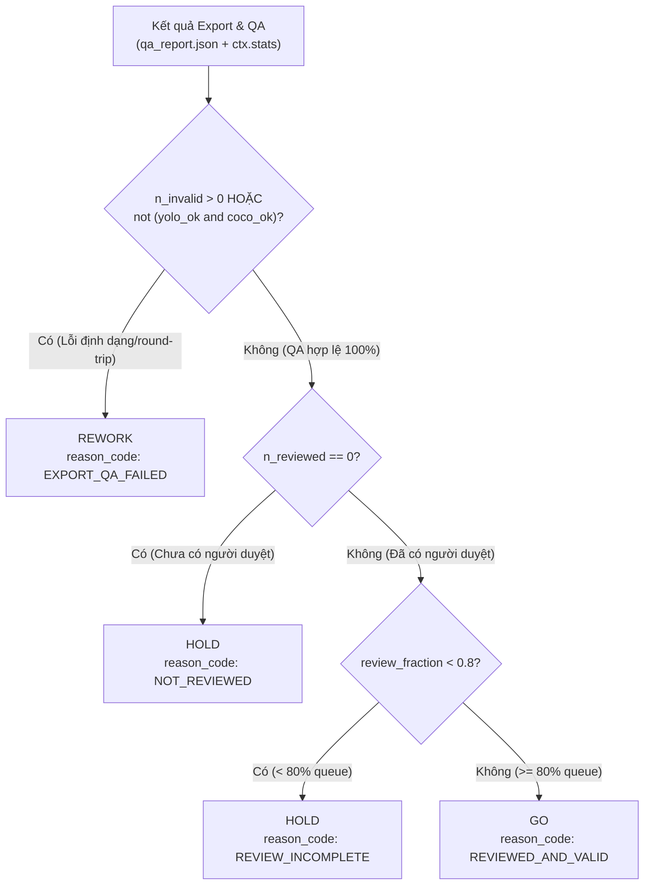

# Báo cáo Tổng hợp & Kiến trúc Hệ thống — T14 Auto-Annotation + Human QC Exporter

- **Nhóm:** `sIx4nhd0cthAn` (`group_id: G01`)
- **Track:** T14 · Auto-Annotation + Human QC Exporter (Day 06 Lab: Data Governance & Privacy)
- **Phụ trách tài liệu (Task E-01 / Issue #12):** Bùi Văn Thịnh (`2A202604040`)
- **Người ký duyệt (`owner`):** `Bui Van Thinh (Lead)`

---

## 1. Bối cảnh & Mục tiêu bài toán

Trong quy trình xây dựng tập dữ liệu cho bài toán nhận thức giao thông (autonomous driving / traffic perception), gán nhãn thủ công 100% tốn rất nhiều chi phí, trong khi sử dụng trực tiếp nhãn từ mô hình pre-trained (auto-annotation) mà không qua kiểm định sẽ gặp 3 rủi ro nghiêm trọng:
1. **Lệch ánh xạ lớp (Schema / Class-map mismatch):** Mô hình pre-trained xuất `class_id` theo chuẩn COCO (`0: person`, `2: car`, `3: motorcycle`, `11: stop sign`), khác hoàn toàn thứ tự của `taxonomy.yaml` dự án (`0: car`, `1: pedestrian`, `2: motorbike`, `3: sign`). Nếu map trực tiếp theo chỉ số (`class_id`), 234/234 box sẽ bị gán sai nhãn hoặc bị mất mà file xuất vẫn có vẻ hợp lệ.
2. **Sót vật thể nhỏ ở xa (Small-object recall drop):** Các đối tượng nhỏ ($w \times h < 150\text{ px}^2$ như người đi bộ hoặc biển báo ở xa) thường có confidence thấp hoặc mấp mé ngưỡng lọc (`conf_threshold = 0.25`), dễ bị loại bỏ bởi ngưỡng tĩnh.
3. **Lỗi hình học khi chuyển đổi định dạng (Export & Round-trip drift):** Bounding box tràn biên ảnh hoặc tọa độ âm gây lỗi khi xuất sang YOLO (`x_center, y_center, w, h` chuẩn hóa $[0,1]$) và COCO (`[x_min, y_min, w, h]` theo pixel).

Hệ thống của nhóm được thiết kế theo 2 luồng rõ ràng, trung thực và tách biệt:
- **Lane A (Chính thức — Bounding Box PoC trên Fixture):** Chạy offline 100% với `--seed 42` trên 60 ảnh `fixtures/t14_auto_annotation` (40 dev / 20 eval).
- **Lane B (Mở rộng — Segmentation Draft trên ảnh thật):** Chạy local offline trên 50 ảnh dev của `data/real/day02_traffic` (UA-DETRAC, CC-BY-4.0, gitignored) kết hợp SegFormer-B2 Cityscapes + YOLO26s-seg để sinh bản nháp polygon khít mép (`gap = 0%`) phục vụ import CVAT.

---

## 2. Sơ đồ Kiến trúc Hệ thống (Architecture Diagram)

### 2.1 Kiến trúc Lane A — Field-to-Release PoC (`src/pipeline.py`)

```mermaid
flowchart LR
    subgraph Input["01. Load & Provenance"]
        A1["manifest.csv\n(SHA-256 verify)"]
        A2["model_predictions_fixture.csv\n(234 raw boxes)"]
        A3["model_card_fixture.yaml\n+ taxonomy.yaml"]
    end

    subgraph Process["02. Adapter, Normalise & Suspicion"]
        B1["build_class_map()\n+ Guard in-taxonomy conflict"]
        B2["normalise_boxes()\n(clip 3 out-of-bounds boxes)"]
        B3["conf >= 0.25 filter\n(227 kept, 7 below thr)"]
        B4["add_suspicion()\nS = 0.5*U + 0.3*small + 0.2*clip + 0.3*conf"]
    end

    subgraph RankReview["03–04. Rank & Human-in-the-Loop QC"]
        C1["make_review_queue()\nTop B=30 highest S"]
        C2["contact_sheet.html\n(Offline Reviewer UI)"]
        C3["review_queue_reviewed.csv\n+ review_additions.csv"]
        C4["apply_review() + AuditLog\n(audit_log.jsonl)"]
    end

    subgraph ExportDecide["05. Multi-Format Export, QA & Decision Gate"]
        D1["validate_predictions()\n(n_invalid = 0)"]
        D2["Export CSV + YOLO + COCO\n+ roundtrip_check (tol <= 0.05px)"]
        D3["decide()\nREWORK / HOLD / GO"]
        D4["decision.json\n+ reports/decision_log.csv"]
    end

    A1 & A2 & A3 --> B1 --> B2 --> B3 --> B4
    B4 --> C1 --> C2 --> C3 --> C4
    C4 --> D1 --> D2 --> D3 --> D4
```

### 2.2 Cổng quyết định phát hành (`src/pipeline.py::decide`)

---

## 3. Kết quả Thực nghiệm & Bằng chứng Kỹ thuật

### 3.1 So sánh Baseline (`src/baseline_t14.py`) và PoC (`src/pipeline.py`) trên Lane A

Chạy cùng cấu hình `configs/lab.yaml`, `--offline --seed 42`, `conf_threshold = 0.25`:

| Chỉ số | Baseline | PoC | Nhận xét |
|---|---|---|---|
| Tổng số box dự đoán đầu vào | 234 | 234 | Từ `model_predictions_fixture.csv` (60 ảnh) |
| Số box xuất ra (`conf >= 0.25`) | 227 | **227** (trước review) / **224** (sau review) | Sau review: approve 10, edit 17, reject 3 box không có vật thể |
| Số box lỗi hình học (`n_invalid`) | **3** (`1.32%`) | **0** (`0.0%`) | PoC tự động clip 3 box tràn biên/âm (`aa_37`, `aa_40`, `aa_56`) |
| Sai số Round-trip YOLO tối đa | Không kiểm tra | **0.00024 px** | Đạt chuẩn (`<= 0.05 px`, `yolo_ok = true`) |
| Sai số Round-trip COCO tối đa | Không kiểm tra | **0.0 px** | Đạt chuẩn (`<= 0.05 px`, `coco_ok = true`) |
| Hàng đợi ưu tiên duyệt (`B = 30`) | 0 | **30 / 30 box đã duyệt** (`100%`) | Bắt được **18/19** box nhỏ (`< 150 px²`) toàn bộ tập |
| Quyết định tự động (`status / reason_code`) | `HOLD / BASELINE_ONLY` | **`GO / REVIEWED_AND_VALID`** | Trước review là `HOLD / NOT_REVIEWED`; sau khi nạp `reports/review_queue.csv` đạt `GO` |
| Thời gian chạy (Runtime) | ~0.03 s | ~0.73 s | Chạy hoàn toàn trên CPU, offline |
| Detection F1@IoU0.5 (20 ảnh eval) | Chờ `gt/` giảng viên | Chờ `gt/` giảng viên | `src.evaluate` trả về exit code `2` do repo học viên không chứa `gt/` |

### 3.2 Hai Failure Cases điển hình đã chứng minh

1. **Failure Case 1 — Map class ID sai vẫn xuất file hợp lệ (`reports/figures/case1_label_map_aa_00.png`):**
   - Trên ảnh `aa_00.jpg`: box `aa_00#0` (`class_id=2` là `car` trong COCO) nếu map trực tiếp sang `taxonomy.yaml` sẽ biến thành `motorbike`; box `aa_00#1` (`class_id=0` là `person`) biến thành `car`; 29 box `stop sign` (`class_id=11`) bị rớt hoàn toàn.
   - **Giải pháp:** `build_class_map()` bắt buộc đối chiếu qua tên lớp và `DEFAULT_ALIAS`, đồng thời chặn các alias mâu thuẫn trong taxonomy hoặc gộp trùng đích.
2. **Failure Case 2 — Tự tin cao ở vật thể lớn nhưng bỏ sót vật thể nhỏ `< 150 px²` (`reports/figures/case2_small_objects_aa_08.png`, `case2_small_sign_aa_02.png`):**
   - Trên ảnh `aa_08.jpg`: các xe ô tô lớn có `conf` từ `0.754` đến `0.896`, nhưng người đi bộ nhỏ ở xa (`aa_08#3`, diện tích `99.8 px²`) chỉ có `conf = 0.297`. Trên ảnh `aa_02.jpg`: xe máy ở xa (`aa_02#4`, `conf = 0.118`) bị lọc bỏ.
   - **Giải pháp:** Cộng trọng số `w_small = 0.3` trong công thức `add_suspicion` để đưa 18/19 box nhỏ vào hàng đợi `review_queue.csv` (top 30), kết hợp cơ chế `review_additions.csv` cho phép người duyệt bổ sung box bị sót.

### 3.3 Kết quả mở rộng Lane B (Segmentation Draft v2 trên 50 ảnh dev thực tế)

Chi tiết tại `docs/benchmark/README.md` và `docs/T14_REAL_EXTENSION.md`:
- Tích hợp pipeline `tools/t14seg/` (`closure.py`, `instances.py`, `cvat_export.py`, `runner.py`) với cơ chế đơn giản hóa biên dùng chung một lần và loại bỏ vùng mờ (`keep_conf=0.35`, `keep_area=100`, `keep_solid=0.8`).
- **Độ hở giữa các polygon (`gap_render_pct` ở opacity 100%):** giảm từ trung bình `0.1566%` (tối đa `0.3176%` ở v1) xuống **0.0% trên cả 50 ảnh dev** (`gap_zero_pass = true`, 0 vi phạm).
- Cơ chế cache theo SHA-256 giúp giảm thời gian chạy lại từ `42.4 s/ảnh` xuống `0.87 s/ảnh`.

---

## 4. Quản trị Dữ liệu, Bản quyền & Đạo đức AI

- **Provenance & Chống rò rỉ dữ liệu:** Toàn bộ file input được kiểm tra SHA-256 qua `manifest.csv` (`strict_provenance: true`). Tuyệt đối không đọc `fixtures/*/gt/`, không gửi request mạng khi chạy (`offline_guard`), không lưu ảnh thật hay token vào Git.
- **Bản quyền mô hình (License):** Ultralytics YOLO26 sử dụng giấy phép **AGPL-3.0** (phù hợp nghiên cứu/học tập; nếu đóng gói thương mại kín cần Enterprise License hoặc chuyển sang mô hình Apache-2.0 như RF-DETR N/S/M/L).
- **Quyền riêng tư (PII):** Fixture của Lane A là dữ liệu tổng hợp (synthetic), không chứa PII thật. Với dữ liệu giao thông thực tế, cần kết hợp bước làm mờ khuôn mặt/biển số và rà soát bởi bộ phận pháp chế/DPO theo Nghị định 13/2023/NĐ-CP trước khi phân phối.

